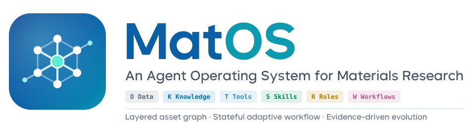
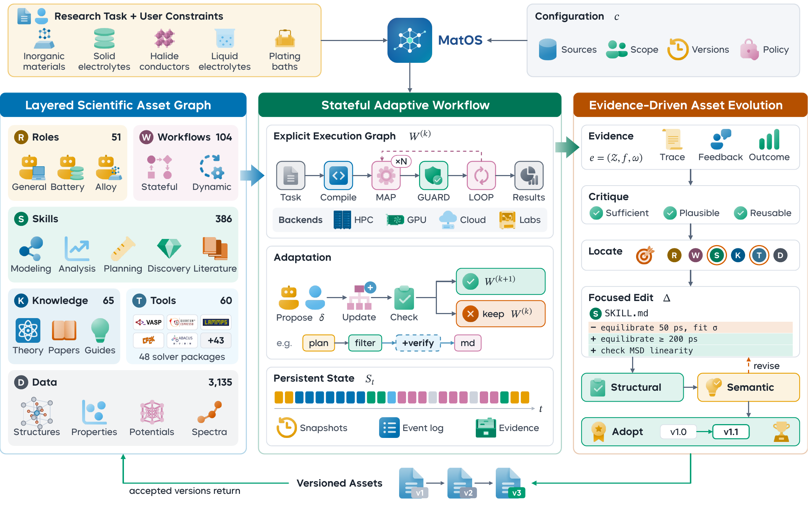
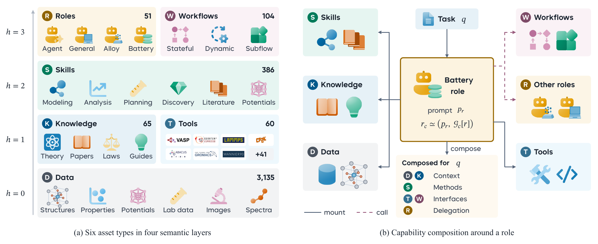
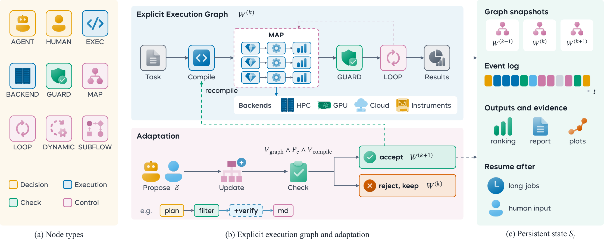
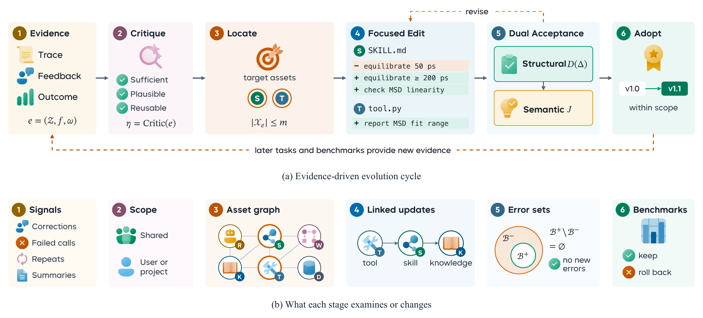
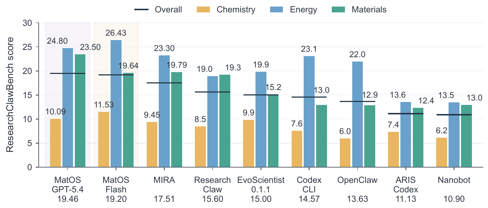
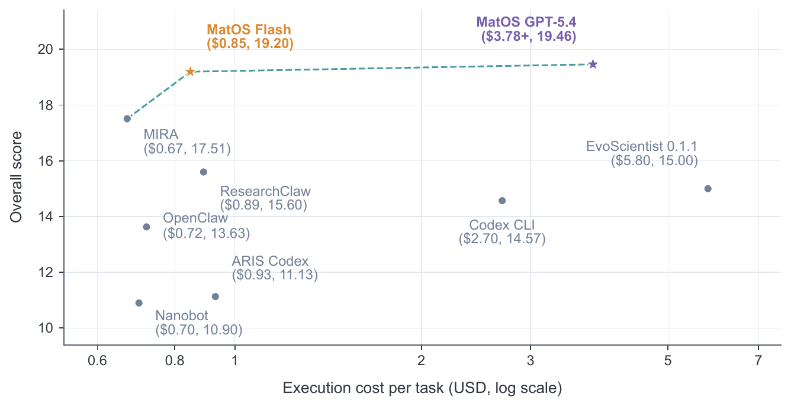
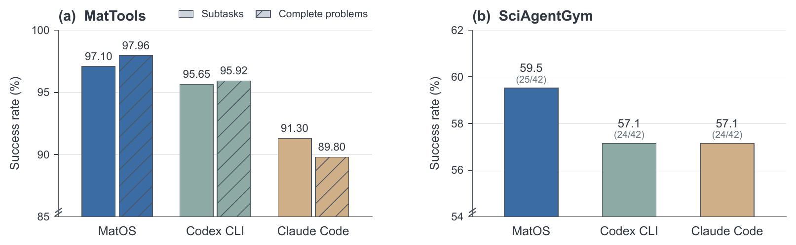

<p align="center">
  <picture>
    <source media="(prefers-color-scheme: dark)" srcset="docs/assets/matos-logo-dark.svg">
    
  </picture>
</p>

<p align="center">
  <strong>Describe a materials research task. MatOS assembles the scientific assets it needs, runs them as a stateful, checkable workflow, and turns every run into better assets for the next one.</strong>
</p>

<p align="center">
  <a href="README_zh.md"></a>&nbsp;
  <a href="LICENSE"></a>&nbsp;
  <a href="https://github.com/bjzgcai"></a>&nbsp;
  &nbsp;
  &nbsp;
  &nbsp;
  
</p>

---

## Contents

- [What is MatOS?](#what-is-matos)
- [Core Design](#core-design)
- [Benchmark Results](#benchmark-results)
- [What's in This Edition](#whats-in-this-edition)
- [Command Line](#command-line)
- [Quick Start](#quick-start)
- [Basic Usage](#basic-usage)
- [Architecture](#architecture)
- [Configuration](#configuration)
- [Running the Benchmarks](#running-the-benchmarks)
- [Documentation](#documentation)
- [Contributing](#contributing)
- [Citation](#citation)

## What is MatOS?

MatOS is an **agent operating system for materials research**. Materials studies run for days, cross literature, computation and experiment, and keep changing as results arrive. Agents for this work have to take on new data and software, keep long tasks on track, and remember what earlier tasks taught them. MatOS builds these capabilities around versioned **scientific assets**: data, knowledge, tools, skills, roles and workflows.

<p align="center"></p>

<p align="center"><em>Research tasks drive the stateful adaptive workflow, the layered scientific asset graph supplies composable capabilities, and execution traces and user feedback become reviewed asset revisions that return to the graph.</em></p>

**Key Features:**

- **Layered scientific asset graph** — six versioned asset types on four semantic layers, linked by six typed relations, in shared, user and project scopes. Adding a capability means adding an asset, and roles reuse assets instead of copying them.
- **Stateful adaptive workflows** — nine node types, DAG and state-machine execution, MAP and LOOP, retries, pauses, cancellation and human approval. Snapshots, an event ledger and per-attempt artifacts let long tasks resume and stay traceable. The agent may propose changes to the graph, and the runtime admits them only after graph, policy and compile checks.
- **Evidence-driven asset evolution** — five hidden system roles turn execution records and feedback into focused asset edits. Each edit must pass structural checks and a semantic review. Approval can be off, manual or automatic, and the Evolution page shows proposals, history and per-asset version lineage.
- **Measured on research benchmarks** — +11.15% over the previous best agent on ResearchClawBench, extending the cost–score Pareto front, and ahead of Codex CLI and Claude Code on MatTools and SciAgentGym with the same base model ([results](#benchmark-results)).
- **Browser workspace** — a customized OpenDesign interface with projects, persistent conversations, files, previews, a terminal, asset and workflow views, and a MatterViz crystal-structure viewer.
- **DeepSeek Harness engine** — DeepSeek Harness (MIT) runs the agent loop and native tools. DeepSeek-V4-Flash is the default model, and any compatible gateway works through `DEEPSEEK_BASE_URL`.
- **One-command deployment** — `./deploy.sh` asks a few questions, runs 18 system checks, downloads a private Node.js and Bun with checksum verification, installs, starts and verifies the model. It needs no root, and every error code has a documented fix.
- **Benchmark runners** — prepare, run and score entrypoints for MatTools, SciAgentGym and ResearchClawBench, with a frozen 28-asset benchmark profile and evolution turned off.

## Core Design

### Layered Scientific Asset Graph

A scientific asset is an object with a unique identifier and type, a declared version and dependencies, and a content entry point or external resource. MatOS distinguishes six types and places them on four semantic layers by their typical prerequisites:

<p align="center"></p>

| Symbol | Type | Layer | Scientific meaning |
|:------:|------|:-----:|--------------------|
| `D` | **Data** | 0 | Records of materials systems and their computational or experimental processes: measurements, simulation outputs, structures, parameters, references to data sources |
| `K` | **Knowledge** | 1 | Generalizations from observations and their conditions of applicability: physical laws, empirical judgments, knowledge about the use of methods |
| `T` | **Tool** | 1 | Callable capabilities centered on materials solvers: software interfaces, retrieval and processing routines, validation scripts, instrument interfaces |
| `S` | **Skill** | 2 | A method for a class of problems: how knowledge and tools are selected and used, and how results are checked |
| `R` | **Role** | 3 | An agent configuration: a responsibility prompt plus the assets it may select, combine and invoke |
| `W` | **Workflow** | 3 | A reusable process that organizes tools, roles and subworkflows through nodes, dependencies and control conditions |

Directed edges `a → b` point from the referencing asset to its referent:

| Relation | Meaning of `a → b` | Typical connection |
|----------|-------------------|--------------------|
| `DEP` | Using `a` requires data, knowledge or a capability supplied by `b` | `S → D, K, T` · `T → K` |
| `MOUNT` | `b` becomes part of the capabilities available to `a` | `R → D, K, T, S, W` · `S → K, T` |
| `CALL` | `a` may delegate a solution or decision to `b` | `R → T, R, W` |
| `PART` | A process described by `a` contains a stage handled by `b` | `W → T, R, W` |
| `EVIDENCE` | `b` supplies traceable evidence for a claim or result in `a` | `K, S, W → D, K` |
| `VERIFY` | `b` specifies or performs a check of `a` | `K, S, W → T, S, W` |

For each task, a role's effective capabilities are composed from the subgraph reachable through `DEP`, `MOUNT` and `CALL` under the current scopes and accepted versions. Several roles can mount the same skill, and different workflows can call the same role.

### Stateful Adaptive Workflow

Model sampling varies, and decisions drift as context changes over a long task. MatOS therefore runs critical computations through an explicit execution graph that holds steps, states and checking rules. The runtime manages parameters, jobs and evidence, while the agent revises plans and interprets anomalies.

<p align="center"></p>

| Node | Responsibility |
|------|----------------|
| `AGENT` | Open decisions such as problem decomposition, method selection and anomaly interpretation, assigned to a research role |
| `EXEC` | A specified computation, data-processing operation or analysis step |
| `BACKEND` | A job on an external computing platform or instrument, through an explicitly supplied adapter |
| `GUARD` | Checks inputs and intermediate results against scientific or procedural conditions |
| `HUMAN` | Stages that need researcher judgment, information or confirmation |
| `SUBWORKFLOW` | A reusable research process invoked as one subtask |
| `MAP` | Expands similar subtasks across candidate materials or conditions |
| `LOOP` | Bounded iteration with repetition limits and stopping conditions |
| `DYNAMIC` | Proposes revisions to later steps and dependencies as the task progresses |

- **Two execution modes.** In DAG mode the scheduler dispatches nodes whose predecessors, inputs and branch conditions are satisfied. In state-machine mode it advances stage by stage through explicit transitions, and transitions back to an earlier stage form feedback loops.
- **State outlives the session.** Graph snapshots, node records and an event ledger persist outside the model's context. A background process can carry a long run and write heartbeats. An observer wakes the agent when the run ends, waits for input or loses its heartbeat, and the agent reads new events through a cursor instead of polling.
- **Checked graph changes.** A proposed update `δ` becomes version `W(k+1)` only if it passes graph-structure, policy and compilation checks. Every proposal, check and decision is recorded, and a rejected proposal leaves the current graph running.

### Evidence-Driven Asset Evolution

Task records and user feedback reveal reusable methods, failure causes, environment requirements and preferences. MatOS writes this experience into assets and keeps the base model fixed.

<p align="center"></p>

1. **Evidence critique**: a critic asks whether the evidence in a trace, the feedback and the workflow outcomes is sufficient, plausible and reusable, and whether it belongs in shared methods or a user's or project's preferences.
2. **Target location**: explicitly named assets come first, and graph relations and textual relevance add related candidates, up to a bounded context.
3. **Focused editing**: an editor proposes a coordinated revision, possibly across several assets or as a new one. A rejected proposal is revised against the stated reasons, up to three attempts.
4. **Dual acceptance**: deterministic checks test descriptions, interfaces and relations. Where a pre-edit baseline exists, errors are compared before and after, so only *new* errors block the edit. A semantic reviewer then confirms that the edit addresses the evidence and preserves the method's applicability.
5. **Adoption**: the accepted version is published to its scope. New conversations use it at once, and open conversations pick it up on their next turn.

| Approval mode | Behavior |
|---------------|----------|
| `off` | No automatic evolution |
| `manual` (default) | Edits that pass every gate wait on the Evolution page until approved or rejected |
| `auto` | Edits that pass every gate are accepted immediately |

Set the mode on the Evolution page, in Settings, with `matos evolve policy`, or for a whole service with `MATOS_EVOLUTION_APPROVAL_MODE`.

## Benchmark Results

MatOS is evaluated at three levels: end-to-end research on [ResearchClawBench](https://arxiv.org/abs/2606.07591), materials tool use on [MatTools](https://arxiv.org/abs/2505.10852), and multistep scientific problem solving on [SciAgentGym](https://arxiv.org/abs/2602.12984). The figures below are from the MatOS technical report.

### End-to-End Research: ResearchClawBench

Twelve chemistry, energy and materials tasks derived from published papers. The system gets the literature and raw data but not the target paper, and must run the study and write a report that experts score against weighted rubric items. MatOS scores **19.20** with DeepSeek-V4-Flash and **19.46** with GPT-5.4, which is **9.63%** and **11.15%** above MIRA, the strongest previously reported GPT-5.4 system. All baselines use GPT-5.4, with scores and costs taken from the MIRA report.

<p align="center"></p>

<p align="center"><em>Domain scores (bars) and overall score (markers, also listed under each system name).</em></p>

Both MatOS configurations extend the observed cost–score Pareto front. DeepSeek-V4-Flash reaches a higher score at a cost close to the strongest baseline's.

<p align="center"></p>

<p align="center"><em>Mean execution cost (log scale) against overall score. The dashed line joins the non-dominated points.</em></p>

### Tool Use: MatTools and SciAgentGym

All three systems use **DeepSeek-V4-Pro** as the base model, so the comparison isolates the agent system. MatTools has 49 problems with 138 property-computation subtasks on pymatgen and its defect extension, checked by unit tests. SciAgentGym has 42 public chemistry and materials cases that require composing domain tools, and a case counts only when the answer is wholly correct.

<p align="center"></p>

<p align="center"><em>(a) MatTools subtask success (solid) and complete-problem success (hatched). (b) SciAgentGym case success, with solved cases in parentheses.</em></p>

### Results Summary

| Benchmark | Base model | MatOS | Strongest baseline |
|-----------|------------|-------|--------------------|
| ResearchClawBench, 12 tasks | DeepSeek-V4-Flash | **19.20** (mean cost $0.85) | MIRA, GPT-5.4: 17.51 ($0.67) |
| ResearchClawBench, 12 tasks | GPT-5.4 | **19.46** (mean cost $3.78+) | MIRA, GPT-5.4: 17.51 ($0.67) |
| MatTools, 49 problems / 138 subtasks | DeepSeek-V4-Pro (all systems) | **48/49** · **134/138** | Codex CLI: 47/49 · 132/138 |
| SciAgentGym, 42 cases | DeepSeek-V4-Pro (all systems) | **25/42** (59.5%) | Codex CLI, Claude Code: 24/42 (57.1%) |

## What's in This Edition

This repository is the open, single-user MatOS edition. It ships two asset profiles:

| | Workspace profile (default) | Benchmark profile |
|---|:---:|:---:|
| Roles | 7 (Compute, Research Scientist + 5 hidden evolution roles) | 2 (Compute, Research Scientist) |
| Skills | 7 | 5 |
| Tools | 18 | 18 |
| Knowledge | 2 | 1 |
| Data (MLIP model records) | 2 | 2 |
| Workflows | 1 (local numerical example) | 0 |
| **Total** | **37** | **28** |
| Evolution | On, manual approval | Off |

Scientific Python environments, MLIP models and benchmark data are installed separately; point MatOS at them in the [configuration](#configuration).

## Command Line

The workspace is the main interface, and everything it does is also available from `bin/matos`. Add `bin/` to `PATH` (`export PATH="$PWD/bin:$PATH"`) or call `bin/matos` directly.

| Command | Description |
|---------|-------------|
| `matos` | Interactive session (`--role`, `--asset` select the role and extra assets) |
| `matos run "<task>"` | Run one task with a role and assets and exit |
| `matos roles list \| show` | Selectable roles and their composed assets |
| `matos assets list \| show \| validate \| graph` | Browse, validate and graph scientific assets |
| `matos skills` | List available skills |
| `matos workflow list \| run \| runs \| inspect \| events` | Run workflows and inspect their runs and event ledger |
| `matos workbench workflows \| projects \| feedback \| models \| search` | Workbench views used by the browser workspace |
| `matos evolve status \| monitor \| feedback \| policy` | Evolution status, feedback and approval mode |
| `matos login status \| set \| test \| reset` | Model credentials and a live connection test |
| `matos usage profile` | Token usage |

Add `--json` to most commands for machine-readable output.

## Quick Start

### One-command setup (recommended)

```bash
git clone https://github.com/DingyangLyu/MatOS.git
cd MatOS
./deploy.sh init   # answer a few questions; writes matos-deploy.conf
./deploy.sh        # check → install → start → verify
```

`./deploy.sh` checks the machine, downloads a private Node.js 24 and Bun 1.3.14 if needed, installs, builds the workspace, starts the service and makes one real model call to verify it. A first deployment takes about 4–10 minutes, and redeploying takes tens of seconds.

Then open **http://127.0.0.1:17474/**. The service listens only on loopback, so from your own computer use an SSH tunnel:

```bash
ssh -N -L 17474:127.0.0.1:17474 you@server
```

On first visit, the welcome page asks for a DeepSeek API key if you did not give one during deployment.

### Prerequisites

- Linux x86_64 with glibc 2.28+ (Ubuntu 20.04+, Debian 10+, RHEL/Rocky/Alma 8+).
- Python 3.9+, Git, a C/C++ compiler and `make`. Node.js and Bun are optional, because the deploy script fetches private copies.
- 4 GB RAM and about 3 GB for the program, plus space for the data directory.
- Network access to the npm registry, the Node/Bun downloads and the DeepSeek API, with mirrors and proxies supported.
- A [DeepSeek API key](https://platform.deepseek.com) or a compatible gateway. Root is **not** needed.

### Day-to-day

| Command | Description |
|---------|-------------|
| `./deploy.sh status` | Is the service running and healthy |
| `./deploy.sh start` / `stop` / `restart` | Control the service |
| `./deploy.sh logs` | Recent service logs (`--lines 200` for more) |
| `./deploy.sh check` | System checks only |
| `./deploy.sh report` | Bundle diagnostics for whoever helps you troubleshoot |
| `./deploy.sh uninstall` | Stop the service and remove autostart; files and data are kept |

Every check and failure prints a code (`C01`–`C18`, `I01`–`I06`, `R01`–`R03`, `A01`). The [deployment guide](docs/deploy.md) (Chinese) explains each code and its fix, plus upgrades, backup and migration.

<details>
<summary><strong>Manual setup</strong> (system Node.js 24 and Bun 1.3.14)</summary>

```bash
bash scripts/matos-setup.sh
# Copy .env.example outside this checkout and set DEEPSEEK_API_KEY.
python3 scripts/matos-service.py start \
  --state-dir /path/to/matos-state \
  --env-file /path/to/private/provider.env \
  --port 17474 --daemon-port 17473
```

Use `scripts/matos-service.py status` or `stop` with the same state directory. `scripts/matos-web.sh` drives the underlying OpenDesign lifecycle manager.

</details>

## Basic Usage

Open a project in the workspace, pick a role and describe the task:

- **Compute** handles materials calculations and tool-centered problems. It plans, checks the local toolchain, writes and runs code, and finalizes answers in the requested form.
- **Research Scientist** handles open-ended studies: literature, data analysis, modeling and a written report.

From the terminal, the same thing is one command:

```bash
bin/matos run --role compute "Build a 2×2×2 rock-salt NaCl supercell with pymatgen and report its density and space group"
```

The agent will:

1. Compose the role's assets (skills, knowledge, tools, workflows) under your current scopes and accepted versions
2. Plan the task and check that the scientific environment it needs is available
3. Run code, tools or workflows, record every step, and check intermediate results
4. Write results, figures and files to the project, and answer in the conversation
5. Leave the trace and your feedback as evidence for the next round of [asset evolution](#evidence-driven-asset-evolution)

## Architecture

```
┌────────────────────────────────────────────────────────────────────┐
│ Browser · OpenDesign workspace                     127.0.0.1:17474 │
│ projects · conversations · files · terminal · assets               │
│ workflows · Evolution page · MatterViz structure viewer            │
└────────────────────────────────────────────────────────────────────┘
                                   │
                                   │ HTTP
                                   │
┌────────────────────────────────────────────────────────────────────┐
│ OpenDesign daemon → native matos commands                   :17473 │
└────────────────────────────────────────────────────────────────────┘
                                   │
                                   │ stream-json
                                   │
┌────────────────────────────────────────────────────────────────────┐
│ MatOS runtime                                                      │
│                                                                    │
│ ┌────────────────────┐ ┌─────────────────────┐ ┌─────────────────┐ │
│ │ Scientific assets  │ │ Workflow runtime    │ │ Evolution       │ │
│ │ D K T S R W        │ │ DAG / state machine │ │ critic → editor │ │
│ │ bundled · user ·   │ │ snapshots · events  │ │ checks → judge  │ │
│ │ project scopes     │ │ artifacts · resume  │ │ → new version   │ │
│ │ local Git refs     │ │ checked graph edits │ │ off/manual/auto │ │
│ └────────────────────┘ └─────────────────────┘ └─────────────────┘ │
│                                                                    │
│ DSH host: role composition · tool rules · skills · MCP             │
└────────────────────────────────────────────────────────────────────┘
                                   │
                                   │ DSH turns
                                   │
┌────────────────────────────────────────────────────────────────────┐
│ DeepSeek Harness: agent loop + native tools (shell, files, web…)   │
└────────────────────────────────────────────────────────────────────┘
                 │                                 │
                 │                                 │
  DeepSeek API / compatible gateway   Host scientific environment
                                      (conda envs, solvers, models)
```

**How it works:**

1. The browser workspace talks to the OpenDesign daemon, which calls native MatOS commands and presents their results
2. When a conversation starts, MatOS resolves the role's capability subgraph under the project's scopes and accepted asset versions
3. The DSH host translates the composed role, tool rules, skills, MCP configuration and session identifiers into DeepSeek Harness turns. DSH runs the agent loop and native tools and streams events back
4. Long or critical computations run as workflows. The runtime schedules nodes, persists state and wakes the agent when a run finishes or needs input
5. Turn feedback and execution records reach the hidden evolution roles. Accepted asset versions are published to the scope's accepted ref and used from the next turn

MatOS owns the scientific system, DeepSeek Harness owns the agent loop, and OpenDesign owns the interface.

## Configuration

<details>
<summary><strong>Deployment file and environment variables</strong></summary>

### Deployment file (`matos-deploy.conf`)

| Key | Default | Description |
|-----|---------|-------------|
| `state_dir` | `~/matos-data` | Projects, conversations, asset versions and run records; must be outside the program directory |
| `web_port` / `daemon_port` | `17474` / `17473` | Workspace and daemon ports |
| `deepseek_api_key` | empty | Optional; can be set in the browser instead, which takes precedence |
| `deepseek_base_url` | empty | Set for a compatible gateway |
| `model` | `deepseek-flash` | Default model |
| `env_file` | `~/.config/matos/matos.env` | Provider settings, written with mode 600 |
| `autostart` | `none` | `none`, `cron` (`@reboot`, no root) or `systemd-user` |
| `npm_registry` / `node_mirror` / `bun_mirror` | official | Mirrors for slow networks |
| `toolchain_root` / `conda_envs_path` / `mlip_model_root` | empty | Your scientific tools, conda environments and MLIP models |

### Environment variables

| Variable | Description |
|----------|-------------|
| `DEEPSEEK_API_KEY` | Provider API key |
| `DEEPSEEK_BASE_URL` | Compatible gateway URL |
| `MATOS_DSH_MODEL` | Model used by the agent (default `deepseek-flash`) |
| `MATOS_TOOLCHAIN_ROOT` / `MATOS_SYSTEM_CONDA_ENVS_PATH` / `MATOS_MLIP_MODEL_ROOT` | Scientific storage on this host |
| `MATOS_EVOLUTION_APPROVAL_MODE` | Fix the evolution mode for a service: `off`, `manual` or `auto` |
| `MATOS_EVOLUTION_DIRECT_EDITOR_MAX_ATTEMPTS` / `MATOS_EVOLUTION_CRITIC_MAX_ATTEMPTS` | Retry limits for the evolution editor and critic (default 3) |

Check the scientific environment with `python3 scripts/matos-science-doctor.py --profile all`.

</details>

## Running the Benchmarks

`scripts/matos-benchmark.sh` is the solver binary for all three harnesses. It pins DeepSeek-V4-Flash, full MatOS context and maximum effort, prepares a private profile per case and disables evolution. Get each benchmark's public data separately and put the provider key in an environment file:

```bash
export MATOS_BENCH_ENV_FILE=/abs/path/to/provider.env
python3 scripts/matos-mattools-agentic-bench.py prepare --mattools-root "$MATTOOLS_ROOT" \
  --mattools-python "$MATTOOLS_PYTHON" --output-root "$RUNS" --run-id matos --json
python3 scripts/matos-mattools-agentic-bench.py run --run-root "$RUNS/matos" --runner matos \
  --matos-bin "$PWD/scripts/matos-benchmark.sh" ...
python3 scripts/matos-mattools-agentic-bench.py score --run-root "$RUNS/matos" --runner matos ...
```

SciAgentGym (`scripts/matos-sciagentgym-bench.py`) and ResearchClawBench (`scripts/matos-rcbench-dsh.py`) follow the same prepare, run and score pattern. Full commands, judge settings and the asset-profile export are in [docs/benchmarks.md](docs/benchmarks.md).

<details>
<summary><strong>Project Structure</strong></summary>

```
MatOS/
├── deploy.sh                    # One-command deployment → scripts/matos-deploy.py
├── bin/matos                    # Command-line entrypoint
├── src/
│   ├── entrypoints/             # matos CLI, agent and evolution-worker entrypoints
│   └── matos/                   # Native runtime
│       ├── assets/              # Asset model, validation, local Git acceptance
│       ├── workflows/           # Workflow runtime: scheduler, snapshots, observers
│       ├── learning/            # Evidence-driven evolution
│       ├── host/                # DSH host: role composition into DSH turns
│       ├── runtime/             # DeepSeek Harness engine, scopes, deployment roots
│       ├── sessions/            # Event and trace recording
│       ├── workbench/           # Actions behind the browser workspace
│       └── cli/                 # matos commands
├── ui/open-design/              # Customized OpenDesign workspace and daemon
├── vendor/deepseek-harness/     # Pinned DeepSeek Harness bundle and MatOS plugin
├── distribution/benchmark-minimal/
│   └── assets/packs/            # The 37-asset workspace / 28-asset benchmark packs
├── scripts/                     # Setup, service, state, export, benchmarks, tests
└── docs/                        # Deployment guide, benchmark guide, figures
```

</details>

## Documentation

| Document | Description |
|----------|-------------|
| [Deployment Guide](docs/deploy.md) | Install, configure, upgrade, back up; every error code (Chinese) |
| [Benchmarks](docs/benchmarks.md) | Running MatTools, SciAgentGym and ResearchClawBench |
| [Licensing](LICENSING.md) · [Third-Party Notices](THIRD_PARTY_NOTICES.md) | License boundaries and upstream notices |

## Contributing

Contributions are welcome, especially **scientific assets**. A new capability is a new asset: an `asset.json` manifest with its id, type, version, dependencies and permissions, plus the content entry point.

```
distribution/benchmark-minimal/assets/packs/<pack>/
├── skills/<name>/      asset.json · SKILL.md
├── roles/<name>/       asset.json · ROLE.md
├── tools/<name>/       asset.json · prompt.md · tool.py · input.schema.json
├── knowledge/<name>/   asset.json · KNOWLEDGE.md
├── data/<name>/        asset.json · DATA.md (references, not large files)
└── workflows/<name>/   asset.json · workflow.json
```

Submissions should include validation evidence and the redistribution license. Validate with `matos assets validate` and run `bash scripts/matos-user-test-regression.sh` before sending changes. Report reproducible issues with the source revision, OS/CPU, toolchain versions and sanitized logs. See [CONTRIBUTING.md](CONTRIBUTING.md).

## Related Projects

- [MatClaw](https://github.com/DingyangLyu/MatClaw): our earlier agent for autonomous materials computation. Describe a task in plain language, and it writes the code, runs DFT, molecular dynamics or Monte Carlo simulations in a container and reports the results.

## Acknowledgments

MatOS builds on the following open-source projects:

- [DeepSeek Harness](https://github.com/deepseek-ai/deepseek-harness): the agent execution engine (MIT)
- [OpenDesign](https://github.com/nexu-io/open-design): the browser workspace and daemon this interface is derived from (Apache-2.0)
- [Coze Studio](https://github.com/coze-dev/coze-studio): native-module code, including graph components, that keeps its Apache-2.0 headers
- [MatterViz](https://github.com/janosh/matterviz) and [Svelte](https://svelte.dev): the bundled crystal-structure viewer (MIT)

The workflow runtime follows the dynamic workflows, error handling and provenance of [FireWorks](https://github.com/materialsproject/fireworks), [AiiDA](https://github.com/aiidateam/aiida-core) and [atomate2](https://github.com/materialsproject/atomate2). Evaluation uses [ResearchClawBench](https://arxiv.org/abs/2606.07591), [MatTools](https://arxiv.org/abs/2505.10852) and [SciAgentGym](https://arxiv.org/abs/2602.12984).

## Roadmap

- [x] Layered asset graph with shared, user and project scopes, local Git acceptance and rollback
- [x] Stateful workflows with checked graph updates, persistent state and background execution
- [x] Evidence-driven evolution with off, manual and automatic approval and an Evolution page
- [x] One-command deployment with system checks and a documented error catalog
- [ ] Connect instruments and experimental protocols to the workflow runtime
- [ ] Link computational and experimental evidence
- [ ] Cross-project asset governance and evaluations of scientific reliability
- [ ] Validated ARM64 and Kylin builds

## Citation

If you use MatOS in your research, please cite the technical report:

```bibtex
@techreport{matos2026,
  title       = {{MatOS}: An Agent Operating System for Materials Research},
  author      = {{AI Materials Team}},
  institution = {Zhongguancun Academy and Zhongguancun Institute of Artificial Intelligence},
  address     = {Beijing, China},
  year        = {2026},
  month       = oct
}
```

Contact: aimaterials@bza.edu.cn

## License

MatOS-authored material is licensed under the [PolyForm Noncommercial License 1.0.0](LICENSE): free for noncommercial use such as research and education. Commercial use is not permitted; for commercial inquiries, contact aimaterials@bza.edu.cn. Third-party components keep their own licenses; see [LICENSING.md](LICENSING.md).
